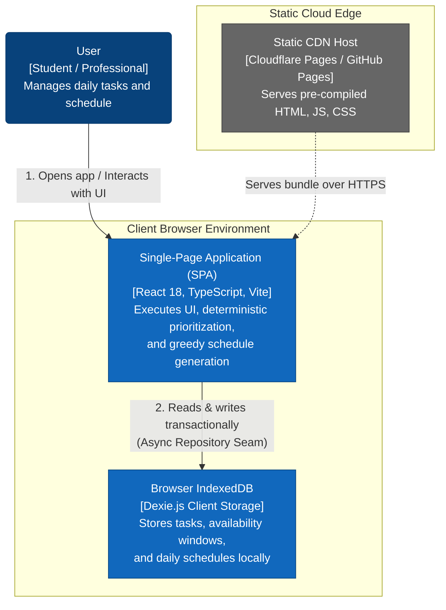
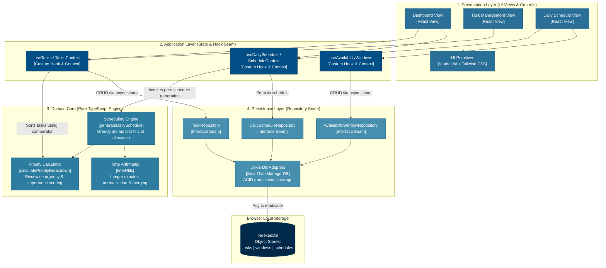

# ADR-0004: Modular Client Monolith Architecture, Component Design, and Public Module Interfaces

> [!IMPORTANT]
> **Deliverable Translation Notice**:
> This document represents the internal, organic Architecture Decision Record drafted during Phase 2 wayfinding.
> Prior to final project submission, this decision **must be translated into the official deliverable format** using `docs/adr-template.md` and saved to `docs/adr/0004-component-architecture-and-module-interfaces.md`.

- **Status:** Accepted (for MVP)
- **Date:** 2026-11-20
- **Decision Makers:** Development Team (`jakspt`)
- **Ticket Reference:** [[#11] Design component architecture and public module interfaces](https://github.com/JohnnyJoster3223/Paise_ProjektWS26/issues/11)

---

## Context and Problem Statement

For Phase 2 of the Smart Task Manager project (`ai_docs/phases/phase_2_architecture.md`) and in alignment with [ADR-0001](0001-architecture-variant-selection.md) (Modular Client Monolith in React/TypeScript), [ADR-0002](0002-client-side-persistence-strategy-and-schema.md) (Client-Side Persistence via Dexie.js), and [ADR-0003](0003-deterministic-priority-and-greedy-scheduling-engine.md) (Pure Priority Scoring & Greedy Scheduling Engine), we must specify the complete component architecture and public module interfaces.

We must define:
1. **Architectural Layering:** The structural boundaries between Presentation (UI), Application (State/Hooks), Domain Core (Logic), and Persistence (Repository Seam).
2. **Public TypeScript Interfaces:** Concise, high-leverage TypeScript contracts across all system seams without Hungarian prefixes (`TaskRepository`, not `ITaskRepository`).
3. **Application State & Reactivity:** The coordination mechanism connecting async persistence to reactive UI views while strictly satisfying NFR-04 (Data Integrity).
4. **Viewer-Friendly C4 Architecture Visualizations:** C4 Level 2 Container and C4 Level 3 Component diagrams clearly illustrating system boundaries and module interactions.

---

## Decision Drivers

1. **Deep Modules & Clean Seams (`codebase-design`):** Modules must present minimal, highly cohesive interfaces while hiding substantial implementation complexity.
2. **Strict Seam Decoupling:** The Presentation and Domain layers must never directly touch Dexie.js or IndexedDB; all storage interactions must cross the asynchronous **Repository Seam**.
3. **Transactional Integrity & Error Resilience (NFR-04):** State mutations must use pessimistic confirmation (awaiting storage commit before updating React state) to prevent false-positive saved states or UI desynchronization.
4. **Zero-Dependency Domain Core:** Scheduling and priority calculations must remain 100% pure functions accepting plain records and injected timestamps (`now: Date`), completely isolated from React or browser DOM APIs.
5. **Simplicity & Minimal Bundle Size:** Leverage idiomatic React Context and custom hooks rather than heavyweight external state libraries (Redux, Zustand, TanStack Query), keeping bundle weight small and maintenance straightforward.
6. **Viewer-Friendly Visual Clarity:** Architecture diagrams must be instantly comprehensible to reviewers, students, and evaluators.

---

## Decision Outcome

**Chosen Architecture:** **Modular Client Monolith with 4 Layered Tiers**

```
┌────────────────────────────────────────────────────────────────────────┐
│ 1. Presentation Layer (React 18 + Vite + Tailwind CSS + shadcn/ui)     │
│    - DashboardView, TaskListView, DailyScheduleView, WindowManagerView │
├────────────────────────────────────────────────────────────────────────┤
│ 2. Application Layer (React Context & Custom Hooks)                    │
│    - TasksContext / useTasks, ScheduleContext / useDailySchedule       │
├────────────────────────────────────────────────────────────────────────┤
│ 3. Domain Core (Pure TypeScript, Zero Dependencies)                    │
│    - calculatePriorityBreakdown, compareTasksByPriority                │
│    - generateDailySchedule, timeUtils (Integer minutes arithmetic)     │
├────────────────────────────────────────────────────────────────────────┤
│ 4. Persistence Layer (Repository Seam & Dexie.js IndexedDB Adapters)   │
│    - TaskRepository, AvailabilityWindowRepository, ScheduleRepository  │
│    - DexieTaskRepository, DexieWindowRepository, DexieScheduleRepo     │
└────────────────────────────────────────────────────────────────────────┘
```

---

## Detailed Specifications

### 1. Public TypeScript Module Interfaces

#### A. Persistence Layer: The Repository Seam (`src/repositories/interfaces.ts`)

Following TypeScript conventions, interface names omit the `I` prefix. All methods return native Promises:

```typescript
import {
  TaskRecord,
  AvailabilityWindowRecord,
  DailyScheduleRecord,
} from '../domain/models';

/**
 * Repository Seam contract for Task persistence.
 */
export interface TaskRepository {
  getAll(): Promise<TaskRecord[]>;
  getById(id: string): Promise<TaskRecord | null>;
  save(task: TaskRecord): Promise<void>;
  saveBulk(tasks: TaskRecord[]): Promise<void>;
  delete(id: string): Promise<void>;
}

/**
 * Repository Seam contract for Availability Window persistence.
 */
export interface AvailabilityWindowRepository {
  getByDate(date: string): Promise<AvailabilityWindowRecord[]>;
  save(window: AvailabilityWindowRecord): Promise<void>;
  saveBulk(windows: AvailabilityWindowRecord[]): Promise<void>;
  delete(id: string): Promise<void>;
}

/**
 * Repository Seam contract for Daily Schedule persistence.
 */
export interface DailyScheduleRepository {
  getByDate(date: string): Promise<DailyScheduleRecord | null>;
  save(schedule: DailyScheduleRecord): Promise<void>;
  delete(date: string): Promise<void>;
}
```

#### B. Domain Core Contracts (`src/domain/`)

Pure functions and immutable calculation outputs (specified in ADR-0003):

```typescript
// src/domain/priority/calculatePriority.ts
export interface PriorityBreakdown {
  score: number; // 20 - 100
  urgencyScore: number; // 10 - 60
  importanceScore: number; // 10 - 40
}

export function calculatePriorityBreakdown(
  task: { deadline?: string; importance?: 'LOW' | 'MEDIUM' | 'HIGH' },
  now: Date
): PriorityBreakdown;

export function compareTasksByPriority(
  a: TaskRecord,
  b: TaskRecord,
  now: Date
): number;

// src/domain/scheduling/engine.ts
export interface ScheduledTaskAllocation {
  taskId: string;
  startTime: string; // "HH:mm"
  endTime: string;   // "HH:mm"
  durationMinutes: number;
}

export interface UnscheduledTaskReport {
  taskId: string;
  reason: 'EXCEEDS_REMAINING_CAPACITY' | 'NO_WINDOWS_AVAILABLE';
}

export interface ScheduleResult {
  date: string;
  generatedAt: string;
  scheduledTasks: ScheduledTaskAllocation[];
  unscheduledTasks: UnscheduledTaskReport[];
  totalAllocatedMinutes: number;
  totalAvailableMinutes: number;
}

export function generateDailySchedule(
  tasks: TaskRecord[],
  windows: AvailabilityWindowRecord[],
  targetDate: string,
  now: Date
): ScheduleResult;
```

#### C. Application Layer: Custom Hooks & State Contracts (`src/application/`)

```typescript
// src/application/hooks/useTasks.ts
export interface UseTasksResult {
  tasks: TaskRecord[];
  isLoading: boolean;
  error: Error | null;
  createTask: (data: Omit<TaskRecord, 'id' | 'createdAt' | 'updatedAt'>) => Promise<string>;
  updateTask: (task: TaskRecord) => Promise<void>;
  toggleTaskCompletion: (id: string) => Promise<void>;
  deleteTask: (id: string) => Promise<void>;
  refreshTasks: () => Promise<void>;
}

// src/application/hooks/useDailySchedule.ts
export interface UseDailyScheduleResult {
  date: string;
  schedule: DailyScheduleRecord | null;
  isLoading: boolean;
  isGenerating: boolean;
  error: Error | null;
  generateSchedule: () => Promise<void>;
  clearSchedule: () => Promise<void>;
}
```

---

### 2. State Mutation & Integrity Strategy (NFR-04 Compliance)

1. **Pessimistic State Updates:**
   Custom hooks await successful IndexedDB commits (`await repository.save(entity)`) before updating React state. Because Dexie operations execute locally within ~1–2 ms, there is no noticeable user lag, and false-positive state displays are completely prevented.
2. **Explicit Error Handling & Notifications:**
   If a repository write rejects (e.g., browser quota exceeded), the catch block captures the error, sets `error`, and invokes a non-intrusive toast notification (via shadcn/ui Toast/Sonner), preserving the previously saved in-memory state.

---

### 3. C4 Architecture Visualizations (Viewer-Friendly)

#### A. C4 Level 2: Container Diagram



#### B. C4 Level 3: Component Diagram (Modular Client Monolith)



---

### 4. Codebase Directory Organization

To enforce architectural depth and prevent circular dependencies:

```
src/
├── domain/                  # Tier 3: Pure domain algorithms (zero dependencies)
│   ├── models/              # TypeScript domain types & records
│   ├── priority/            # Priority scoring & comparator
│   └── scheduling/          # Greedy first-fit engine & time arithmetic
├── repositories/            # Tier 4: Public Repository Seam & Dexie adapters
│   ├── interfaces.ts        # TaskRepository, AvailabilityWindowRepository, etc.
│   └── dexie/               # Dexie.js database instance & adapter implementations
├── application/             # Tier 2: Application state, React Contexts, custom hooks
│   ├── context/             # TasksContext, ScheduleContext, AvailabilityContext
│   └── hooks/               # useTasks, useDailySchedule, useAvailabilityWindows
└── components/              # Tier 1: Presentation layer
    ├── views/               # DashboardView, TaskListView, ScheduleView
    ├── layout/              # Navbar, Sidebar, AppLayout
    └── ui/                  # shadcn/ui primitives (Button, Card, Dialog, Toast)
```

---

## Architectural Consequences & Accepted Trade-offs

### Positive Consequences
- **High Architectural Depth:** Domain Core and Repositories expose concise, minimal surfaces while encapsulating robust algorithmic and database logic.
- **Trivial Seam Testing:**
  - Domain algorithms are tested via simple pure input/output unit tests.
  - Custom hooks are tested with in-memory mock repository adapters (`InMemoryTaskRepository`) without IndexedDB overhead.
- **Painless Evolutionary Path:** To evolve to a client-server architecture (Variant B), only the adapters under `src/repositories/` need to be swapped with HTTP fetch implementations; the Domain Core, Application Hooks, and Presentation components remain untouched.

### Accepted Trade-offs
- **Context Re-renders:** Global Context updates cause component tree evaluations; mitigated by splitting into three focused contexts (`TasksContext`, `ScheduleContext`, `AvailabilityContext`) rather than a single massive state blob.
