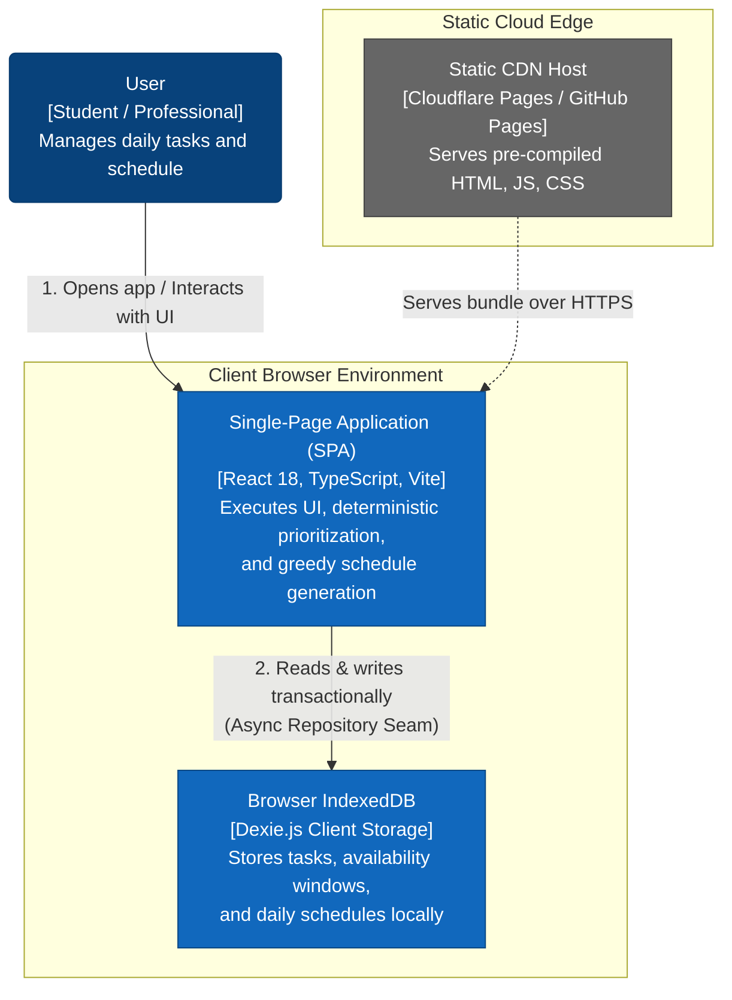
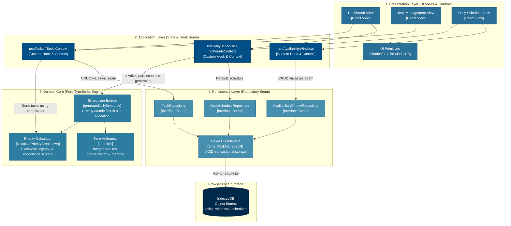

# Adopt Modular Client Monolith Architecture with Four-Tier Layering and Async Repository Seam

## Context and Problem Statement

Following the adoption of a Pure Client-Side Single-Page Application ([ADR-0001](file:///c:/Users/Jakob/Documents/Master%20SE/Paise_ProjektWS26/docs/adr/0001-architecture-variant-selection.md)), an IndexedDB persistence engine ([ADR-0002](file:///c:/Users/Jakob/Documents/Master%20SE/Paise_ProjektWS26/docs/adr/0002-client-side-persistence-strategy-and-schema.md)), and a pure deterministic scheduling core ([ADR-0003](file:///c:/Users/Jakob/Documents/Master%20SE/Paise_ProjektWS26/docs/adr/0003-deterministic-priority-and-greedy-scheduling-engine.md)), we must establish the overall component architecture and public module interfaces for the Smart Task Manager.

We must define:
1. **Architectural Layering:** The structural boundaries between Presentation (UI views and design system), Application (React Contexts and custom hooks), Domain Core (pure algorithms), and Persistence (Repository Seam).
2. **Public TypeScript Contracts:** Clean, cohesive interfaces across system seams following idiomatic TypeScript practices without Hungarian naming prefixes (`TaskRepository`, not `ITaskRepository`).
3. **Application State & Reactivity:** The synchronization mechanism connecting asynchronous persistence to reactive UI views while strictly satisfying NFR-04 (Data Integrity).
4. **Viewer-Friendly Visualizations:** C4 Level 2 Container and C4 Level 3 Component diagrams clearly communicating boundaries and interactions to students, instructors, and evaluators.

## Decision Drivers

* **High Architectural Depth & Clean Seams (`codebase-design`):** Modules must present minimal, highly cohesive public interfaces while encapsulating substantial algorithmic and storage complexity.
* **Strict Seam Decoupling:** The Presentation and Domain layers must never directly import Dexie.js or touch browser IndexedDB; all storage interactions must cross the asynchronous **Repository Seam**.
* **Transactional State Integrity (NFR-04):** State mutations must use pessimistic confirmation (awaiting storage commit before updating React state) to prevent false-positive saved states or UI desynchronization.
* **Zero-Dependency Domain Core:** Scheduling and priority calculations must remain 100% pure functions accepting plain records and injected timestamps (`now: Date`), completely isolated from React or browser DOM APIs.
* **Simplicity & Minimal Bundle Size:** Leverage idiomatic React Context and custom hooks rather than heavyweight external state libraries (Redux, Zustand, TanStack Query), keeping bundle weight small and maintenance straightforward.
* **Viewer-Friendly Visual Clarity:** Architecture diagrams must be instantly comprehensible to reviewers and evaluators.

## Considered Options

* Option 1: Four-Tier Modular Client Monolith with React Context and Async Repository Seam
* Option 2: Feature-Sliced Design (FSD) with Redux Toolkit and RTK Query
* Option 3: Two-Tier UI-Coupled Architecture (Direct Dexie Calls from React Components)

## Decision Outcome

Chosen option: "Option 1: Four-Tier Modular Client Monolith with React Context and Async Repository Seam", because it establishes clean, defensible boundaries between Presentation, Application, Domain, and Persistence layers, guarantees NFR-04 data integrity through pessimistic state updates, enables isolated unit testing of domain and repository logic, and avoids the unnecessary boilerplate of external state managers.

### Consequences

* Good, because the Repository Seam (`TaskRepository`, `AvailabilityWindowRepository`, `DailyScheduleRepository`) strictly decouples data storage from UI components, enabling a frictionless future transition to remote REST APIs (Variant B).
* Good, because the Domain Core remains pure TypeScript with zero runtime dependencies, allowing exhaustive unit testing in Vitest without React hooks or DOM environments.
* Good, because pessimistic hook updates ensure React state accurately reflects durable storage, fulfilling NFR-04.
* Good, because using standard React Context and custom hooks keeps bundle size minimal and avoids external framework lock-in.
* Bad, because global React Context updates trigger component re-evaluations (mitigated by partitioning into three focused domain contexts: `TasksContext`, `ScheduleContext`, and `AvailabilityContext`).
* Neutral, because developer discipline is required to maintain architectural boundaries (enforced via ESLint import restrictions and code reviews).

### Confirmation

Compliance with this decision is confirmed through:
1. **Architectural Boundary Linting:** ESLint rules enforce import boundaries: `src/components/` and `src/domain/` may not import from `src/repositories/dexie/` or `dexie`.
2. **Seam Mock Testing:** Application hooks in `src/application/hooks/` are tested with in-memory repository doubles (`InMemoryTaskRepository`) without IndexedDB or DOM overhead.
3. **Interface Compliance:** Strict TypeScript compilation with `noImplicitAny` and `strictNullChecks` validates that all repository implementations conform to their contracts without Hungarian prefixes.

## Pros and Cons of the Options

### Option 1: Four-Tier Modular Client Monolith with React Context and Async Repository Seam

A classic layered architecture partitioned into Presentation, Application, Domain Core, and Persistence, connected via asynchronous interfaces and React Contexts.

* Good, because boundaries are clear, intuitive, and widely understood by software engineers.
* Good, because domain logic and repository adapters are trivially testable in isolation.
* Good, because it requires zero third-party state management libraries, keeping the bundle lean.
* Good, because the asynchronous Repository Seam preserves an evolutionary path to remote backends.
* Neutral, because context splitting is needed to avoid unnecessary re-renders.
* Bad, because simple CRUD operations require touching multiple layers (interface, repository adapter, hook, view).

### Option 2: Feature-Sliced Design (FSD) with Redux Toolkit and RTK Query

A strict slice-based architectural framework organizing code into layers (app, pages, widgets, features, entities, shared) backed by Redux Toolkit and RTK Query.

* Good, because it enforces strict standardized conventions across large teams.
* Good, because Redux Toolkit offers granular selector-based re-render optimization.
* Bad, because it introduces massive boilerplate, action creators, reducers, and slice definitions for a single-developer or small-team MVP.
* Bad, because Redux Toolkit and RTK Query add ~40–60 KB of unnecessary bundle weight.
* Bad, because FSD conventions are overly rigid for a client-side utility tool, violating the "Keep it Simple" requirement of Phase 2.

### Option 3: Two-Tier UI-Coupled Architecture (Direct Dexie Calls from React Components)

React components directly query and mutate Dexie database tables via Dexie React hooks (`useLiveQuery`).

* Good, because it requires the fewest files and boilerplate for initial rapid prototyping.
* Bad, because business logic and storage calls become deeply entangled in UI components, making automated unit testing difficult.
* Bad, because it completely violates architectural layering and eliminates the Repository Seam, making any future backend migration require a total UI rewrite.
* Bad, because it fails the software architecture evaluation criteria for clean separation of concerns.

## More Information

### Architectural Layering Structure

```
┌────────────────────────────────────────────────────────────────────────┐
│ 1. Presentation Layer (React 18 + Vite + Tailwind CSS + shadcn/ui)     │
│    - DashboardView, TaskListView, DailyScheduleView, WindowManagerView │
├────────────────────────────────────────────────────────────────────────┤
│ 2. Application Layer (React Context & Custom Hooks)                    │
│    - TasksContext / useTasks, ScheduleContext / useDailySchedule       │
├────────────────────────────────────────────────────────────────────────┤
│ 3. Domain Core (Pure TypeScript, Zero Dependencies)                    │
│    - calculatePriorityBreakdown, compareTasksByPriority                │
│    - generateDailySchedule, timeUtils (Integer minutes arithmetic)     │
├────────────────────────────────────────────────────────────────────────┤
│ 4. Persistence Layer (Repository Seam & Dexie.js IndexedDB Adapters)   │
│    - TaskRepository, AvailabilityWindowRepository, ScheduleRepository  │
│    - DexieTaskRepository, DexieWindowRepository, DexieScheduleRepo     │
└────────────────────────────────────────────────────────────────────────┘
```

---

### Public TypeScript Module Interfaces

#### Persistence Layer: The Repository Seam (`src/repositories/interfaces.ts`)

```typescript
import {
  TaskRecord,
  AvailabilityWindowRecord,
  DailyScheduleRecord,
} from '../domain/models';

/**
 * Repository Seam contract for Task persistence.
 */
export interface TaskRepository {
  getAll(): Promise<TaskRecord[]>;
  getById(id: string): Promise<TaskRecord | null>;
  save(task: TaskRecord): Promise<void>;
  saveBulk(tasks: TaskRecord[]): Promise<void>;
  delete(id: string): Promise<void>;
}

/**
 * Repository Seam contract for Availability Window persistence.
 */
export interface AvailabilityWindowRepository {
  getByDate(date: string): Promise<AvailabilityWindowRecord[]>;
  save(window: AvailabilityWindowRecord): Promise<void>;
  saveBulk(windows: AvailabilityWindowRecord[]): Promise<void>;
  delete(id: string): Promise<void>;
}

/**
 * Repository Seam contract for Daily Schedule persistence.
 */
export interface DailyScheduleRepository {
  getByDate(date: string): Promise<DailyScheduleRecord | null>;
  save(schedule: DailyScheduleRecord): Promise<void>;
  delete(date: string): Promise<void>;
}
```

#### Application Layer: Custom Hooks & State Contracts (`src/application/`)

```typescript
// src/application/hooks/useTasks.ts
export interface UseTasksResult {
  tasks: TaskRecord[];
  isLoading: boolean;
  error: Error | null;
  createTask: (data: Omit<TaskRecord, 'id' | 'createdAt' | 'updatedAt'>) => Promise<string>;
  updateTask: (task: TaskRecord) => Promise<void>;
  toggleTaskCompletion: (id: string) => Promise<void>;
  deleteTask: (id: string) => Promise<void>;
  refreshTasks: () => Promise<void>;
}

// src/application/hooks/useDailySchedule.ts
export interface UseDailyScheduleResult {
  date: string;
  schedule: DailyScheduleRecord | null;
  isLoading: boolean;
  isGenerating: boolean;
  error: Error | null;
  generateSchedule: () => Promise<void>;
  clearSchedule: () => Promise<void>;
}
```

---

### State Mutation & Integrity Strategy (NFR-04 Compliance)

1. **Pessimistic State Updates:** Custom hooks await successful IndexedDB commits (`await repository.save(entity)`) before updating React state. Because Dexie operations execute locally within ~1–2 ms, there is no noticeable user lag, and false-positive state displays are completely prevented.
2. **Explicit Error Handling & Notifications:** If a repository write rejects (e.g., browser quota exceeded), the catch block captures the error, sets `error`, and invokes a non-intrusive toast notification (via shadcn/ui Toast/Sonner), preserving the previously saved in-memory state.

---

### C4 Architecture Visualizations

#### C4 Level 2: Container Diagram



#### C4 Level 3: Component Diagram (Modular Client Monolith)



---

### Codebase Directory Organization

```
src/
├── domain/                  # Tier 3: Pure domain algorithms (zero dependencies)
│   ├── models/              # TypeScript domain types & records
│   ├── priority/            # Priority scoring & comparator
│   └── scheduling/          # Greedy first-fit engine & time arithmetic
├── repositories/            # Tier 4: Public Repository Seam & Dexie adapters
│   ├── interfaces.ts        # TaskRepository, AvailabilityWindowRepository, etc.
│   └── dexie/               # Dexie.js database instance & adapter implementations
├── application/             # Tier 2: Application state, React Contexts, custom hooks
│   ├── context/             # TasksContext, ScheduleContext, AvailabilityContext
│   └── hooks/               # useTasks, useDailySchedule, useAvailabilityWindows
└── components/              # Tier 1: Presentation layer
    ├── views/               # DashboardView, TaskListView, ScheduleView
    ├── layout/              # Navbar, Sidebar, AppLayout
    └── ui/                  # shadcn/ui primitives (Button, Card, Dialog, Toast)
```

### Component Architecture Comparison Matrix

| Evaluation Criterion | Option 1: 4-Tier Modular Monolith (Selected) | Option 2: Feature-Sliced Design (FSD) | Option 3: Two-Tier UI Coupled |
|---|---|---|---|
| **Separation of Concerns** | **High** (Strict layer boundaries) | **Very High** (Strict slice boundaries) | **Poor** (Entangled UI and DB) |
| **Testability of Domain Logic** | **100%** (Pure functions, zero mocks) | **High** | **Low** (Tied to React lifecycle) |
| **Boilerplate & Mental Overhead** | **Low** (Simple hooks and interfaces) | **Very High** (Slices, selectors, reducers) | **Minimal** (Rapid proto only) |
| **Evolutionary Backend Path** | **Native** (Swap Repository Seam) | **Native** (Swap RTK Query endpoints) | **None** (Requires complete rewrite) |
| **Bundle Size Overhead** | **Zero** (Standard React built-ins) | **~40–60 KB** (Redux + RTK Query) | **Zero** |
| **Team Fit & Velocity** | **Optimal** for semester project | **Over-engineered** | **Risky** (High technical debt) |

### References & Links

* Wayfinding Ticket: [#11 Design component architecture and public module interfaces](https://github.com/JohnnyJoster3223/Paise_ProjektWS26/issues/11)
* Parent Architecture Variant: [0001-architecture-variant-selection.md](file:///c:/Users/Jakob/Documents/Master%20SE/Paise_ProjektWS26/docs/adr/0001-architecture-variant-selection.md)
* Client Persistence & Schema: [0002-client-side-persistence-strategy-and-schema.md](file:///c:/Users/Jakob/Documents/Master%20SE/Paise_ProjektWS26/docs/adr/0002-client-side-persistence-strategy-and-schema.md)
* Domain Core & Scheduling Engine: [0003-deterministic-priority-and-greedy-scheduling-engine.md](file:///c:/Users/Jakob/Documents/Master%20SE/Paise_ProjektWS26/docs/adr/0003-deterministic-priority-and-greedy-scheduling-engine.md)
