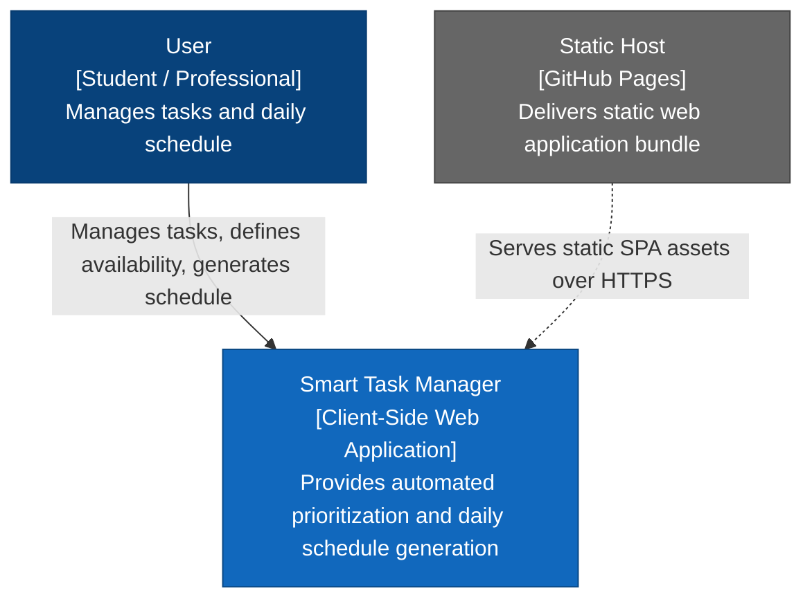
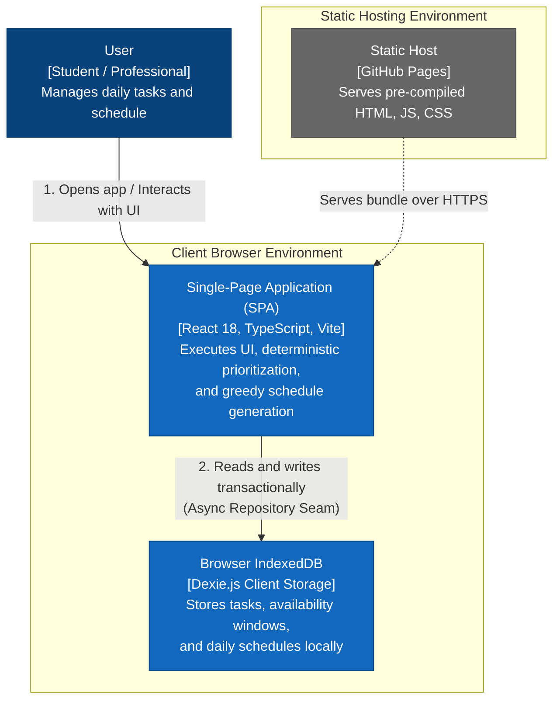
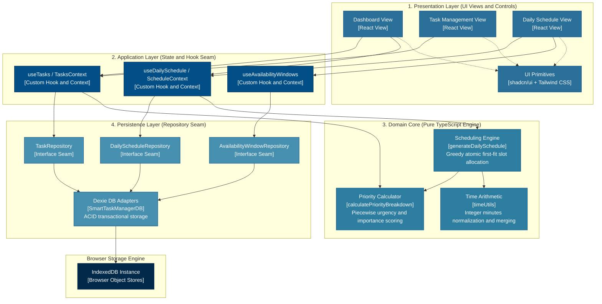

# Software Architecture Specification: Smart Task Manager

> **Document:** `docs/architecture.md`  
> **Phase:** Phase 2 – Software Architecture & Infrastructure Specification  
> **Target Application:** Smart Task Manager (Client-side React 18+ / TypeScript / Vite SPA)  
> **Status:** Approved / Specification Complete  
> **Last Updated:** 2026-11-21  
> **Related Documents:** [Hosting Specification](hosting.md), [Requirements Specification](requirements.md), [MVP Scope](mvp.md), [ADR Directory](adr/README.md), [Domain Glossary](../GLOSSARY.md)

---

## 1. Executive Summary & Architectural Vision

Smart Task Manager is a client-side web application designed to help users organize their daily workload by automatically prioritizing tasks and scheduling them into user-defined time windows. The application operates entirely within the user's browser without requiring a backend server, account registration, or cloud database subscription.

Conventional productivity tools frequently cause friction by overwhelming users with unbounded to-do lists, manual calendar time-blocking, or unpredictable automated suggestions. Smart Task Manager resolves this by automating the **Core Planning Loop**:
1. **Frictionless Task Capture:** Recording tasks with minimal required fields (non-empty title) and optional estimation attributes (positive duration, deadline, and discrete importance level).
2. **Deterministic Priority Ranking:** Eliminating subjective prioritization stress through a transparent, rule-based mathematical scoring formula.
3. **Automated Daily Schedule Generation:** Allocating tasks into user-defined daily availability windows using an atomic, non-overlapping greedy first-fit scheduling algorithm.
4. **Actionable Day View:** Prominently displaying the next pending scheduled task and planned start time without requiring clicks into task detail screens (directly addressing NFR-01).

```
                      THE CORE PLANNING LOOP
                      
   [ 1. Capture Tasks ] ────> [ 2. Deterministic Scoring ]
   (Title, Est. Mins,         (Piecewise Urgency + 
    Deadline, Importance)      Importance -> 20..100)
                                        │
                                        ▼
   [ 4. Actionable Day View ] <──── [ 3. Daily Schedule Generation ]
   (Next task start time      (Greedy Atomic First-Fit
    visible immediately)       into Availability Windows)
```

> ### Key Decisions at a Glance
> * **Zero Server Overhead:** Pure client-side Single-Page Application (SPA) in React 18 and TypeScript; all computation and UI execution occur locally in the browser.
> * **Local Data Persistence:** Tasks, availability windows, and daily schedules are stored locally in IndexedDB using Dexie.js for multi-store ACID reliability (NFR-03, NFR-04).
> * **Deterministic Prioritization:** Tasks are ranked objectively using a composite score (20–100) calculated transparently from deadline urgency and importance ratings.
> * **Greedy Atomic Scheduling:** Unscheduled tasks are slotted into availability windows using a greedy first-fit algorithm without splitting tasks across windows or days.
> * **Zero-Cost Static Hosting:** Deployed on GitHub Pages via automated GitHub Actions with zero operational hosting fees.
> * **Evolutionary Repository Seam:** UI views and custom hooks depend exclusively on abstract repository interfaces, allowing an HTTP REST backend to be integrated in future phases without rewriting presentation or domain code.

### Architectural Principles

The software architecture is governed by four core tenets:
* **Simplicity over Speculative Architecture ("Keep It Simple"):** Delivering the MVP as a pure client-side single-page application without unnecessary microservices, external databases, message brokers, or heavy framework boilerplate.
* **Domain Purity & Testability:** Isolating business rules (priority scoring, schedule generation, integer minute arithmetic) inside pure, zero-dependency TypeScript modules capable of 100% deterministic unit test coverage.
* **High Architectural Depth via Clean Seams:** Decoupling user interfaces and state hooks from concrete storage engines via an asynchronous **Repository Seam** based on the Ports and Adapters (Hexagonal) pattern.
* **Transactional Integrity & Local Ownership:** Guaranteeing ACID persistence and error rollback via IndexedDB (Dexie.js), ensuring complete data privacy and offline autonomy without subscription costs or hosting bills.

---

## 2. Requirements & Architectural Drivers

The architecture directly realizes the functional requirements (FRs), non-functional requirements (NFRs), and scope boundaries established in [requirements.md](requirements.md) and [mvp.md](mvp.md):

### 2.1 Traceability Matrix

| Requirement Group | Key Requirement IDs | Architectural Mechanism & Seam |
| :--- | :--- | :--- |
| **Task Management** | **FR-TM-01** (Create Task)<br/>**FR-TM-02** (Edit Task)<br/>**FR-TM-03** (Delete Confirmation)<br/>**FR-TM-04** (Optional Deadlines & Importance)<br/>**FR-TM-05** (Positive Duration) | Managed via `TaskRecord` entity; UUID v4 client-generated keys; validated in `TaskRepository` seam; positive integer durations enforced; optional deadline and importance. |
| **Daily Planning** | **FR-DP-01** (Availability Windows)<br/>**FR-DP-02** (Priority Calculation)<br/>**FR-DP-03** (Priority Recalculation)<br/>**FR-DP-04** (Schedule Generation)<br/>**FR-DP-05** (Non-overlapping Placement) | `AvailabilityWindowRecord` normalized to integer minutes from midnight; `calculatePriorityBreakdown` and `generateDailySchedule` pure functions; atomic slot allocation preventing overlaps. |
| **Daily Review** | **FR-DR-01** (Priority Ordered List)<br/>**FR-DR-02** (Day Plan View)<br/>**FR-DR-04** (Completion Marking) | Master unfinished list sorted via `compareTasksByPriority`; `DailyScheduleRecord` aggregate stores day allocation; unscheduled tasks derived dynamically; completed tasks excluded from scheduling. |
| **Usability** | **NFR-01** | Sub-millisecond synchronous client scheduling; immediate visibility of next pending scheduled task and start time on the main dashboard without modal clicks. |
| **Accessibility** | **NFR-02** | Presentation layer design system (shadcn/ui + Tailwind CSS) guarantees task states (scheduled, unscheduled, completed) are distinguishable via text labels and distinct shapes, never relying on color alone. |
| **Data Persistence** | **NFR-03** | IndexedDB durable client storage via Dexie.js; automatic schema versioning; durable across browser restarts and page reloads. |
| **Data Integrity** | **NFR-04** | ACID transactional boundaries (`db.transaction('rw', ...)`); automatic write rollback upon storage quota errors; pessimistic React hook updates prevent desynchronization. |

---

## 3. Architecture Variant Evaluation & Selection

In compliance with Phase 2 requirements, two architectural variants were evaluated:
* **Variant A:** Pure Client-Side Single-Page Application (SPA) in React and TypeScript.
* **Variant B:** Client-Server Fullstack Architecture with C# ASP.NET Core Minimal API and Relational Database.

### 3.1 Comparative Evaluation Matrix

| Evaluation Dimension | Variant A: Pure Client-Side SPA (Selected) | Variant B: Fullstack C# ASP.NET Core | Rationale & Architectural Impact |
| :--- | :--- | :--- | :--- |
| **Alignment with MVP Scope** | **High** (Direct match) | **Low** (Over-engineered) | MVP is single-user, local-first. A remote server adds unneeded infrastructure without user value. |
| **Hosting & Operational Cost** | **$0.00 / month** (Static CDN) | **$10–$30+ / month** (App Service + DB) | Static hosting on GitHub Pages has zero ongoing cost and zero maintenance overhead. |
| **Interactive Latency (NFR-01)** | **Sub-millisecond (< 2 ms)** | **100–350 ms + Cold Starts** | Client-side memory and IndexedDB guarantee instant UI responsiveness, preventing hesitation. |
| **Offline Capability** | **Native (100% offline-capable)** | **Complex (Requires PWA sync queue)** | Local storage functions seamlessly without network availability. |
| **Data Privacy & Compliance** | **Optimal (Data never leaves device)** | **Medium (Server storage, GDPR, auth)** | Zero server-side data exposure eliminates user privacy compliance risks and attack vectors. |
| **Implementation Velocity** | **High (Unified TypeScript stack)** | **Medium/Low (Two runtimes, migrations)** | Single-language codebase allows the team to deliver full functionality within the semester. |
| **Multi-Device Synchronization** | **None (Local browser storage)** | **Native (Centralized database)** | Multi-device sync is explicitly an out-of-scope non-goal for the MVP (see `docs/mvp.md`). |
| **Extensibility & Migration** | **High via Repository Seam** | **High** | The asynchronous Repository Seam allows adding a REST backend post-MVP without rewriting UI. |

### 3.2 Decision Outcome & Justification

**Selected Option:** **Variant A: Pure Client-Side Single-Page Application (SPA)** (formally recorded in [ADR-0001](adr/0001-architecture-variant-selection.md)).

**Justification:**
1. **Direct Alignment with Single-User MVP:** The MVP focuses on validating the core anti-procrastination scheduling logic for individual users. Introducing user authentication, JWT lifecycle management, cloud database hosting, and network error recovery prematurely inflates scope and development risk.
2. **Guaranteed Zero Operational Cost:** Deployable to global static hosting (GitHub Pages) without server hosting expenses, compute limits, or database administration.
3. **Sub-Millisecond Anti-Procrastination Latency:** Eliminates network round-trips and server cold starts. Schedule generation and task state toggles execute instantaneously, removing cognitive friction.
4. **Data Ownership and Privacy:** User tasks, schedules, and daily availability records reside exclusively within the user's browser, eliminating data breach liabilities.

### 3.3 Preserving the Evolutionary Path: The Repository Seam

Selecting Variant A does not lock the project into a client-only topology. To ensure seamless post-MVP evolution to Variant B (or cloud synchronization), the system introduces an asynchronous **Repository Seam** based on the Ports and Adapters (Hexagonal) architecture.

Because presentation components and application hooks consume solely the abstract repository interfaces (`TaskRepository`, `AvailabilityWindowRepository`, `DailyScheduleRepository`), swapping local IndexedDB for remote HTTP endpoints requires only providing new adapter implementations (`HttpTaskRepository`). The UI components, state hooks, and pure domain algorithms remain completely unchanged. (The four-tier architecture and Repository Seam structure are visualized in the C4 Level 3 Component Diagram in §5.3.)

### 3.4 Evaluation of Alternative Architectural Patterns

During architectural design, three common architectural patterns were evaluated and deliberately set aside to maintain simplicity, predictable performance, and intuitive user behavior:

#### 3.4.1 State Management: React Context vs. Redux Toolkit
* **Alternative Considered:** Employing Redux Toolkit with RTK Query or Redux Sagas for centralized client state management.
* **Trade-Off Analysis:** The Smart Task Manager MVP manages only three domain entities (`TaskRecord`, `AvailabilityWindowRecord`, `DailyScheduleRecord`) in a single-user flow. Redux Toolkit introduces significant slice and action boilerplate and adds ~40–60 KB to the bundle.
* **Selected Decision:** Three focused React 18 Contexts (`TasksContext`, `ScheduleContext`, `AvailabilityContext`) paired with custom hooks. This keeps state management lightweight, idiomatic, and maintainable with zero external library dependencies.

#### 3.4.2 Scheduling Core: Deterministic Greedy First-Fit vs. Dynamic Programming / CSP Solvers
* **Alternative Considered:** Using an exact 0/1 Knapsack dynamic programming solver or an external Constraint Satisfaction Problem (CSP) library to maximize scheduled minutes.
* **Trade-Off Analysis:**
  1. *The Knapsack Packing Anomaly:* Bin-packing optimization frequently skips a high-priority, urgent task simply because its duration does not perfectly fill a remaining time fragment, substituting an unimportant task instead. This counter-intuitive behavior destroys user trust.
  2. *Runtime Complexity:* CSP libraries introduce worst-case exponential execution time, risking UI thread lockups.
* **Selected Decision:** A pure TypeScript **Greedy Atomic First-Fit** scheduler. It respects strict priority order, runs in sub-millisecond O(N log N) time, and provides transparent, predictable scheduling.

#### 3.4.3 System Architecture: Pure Client SPA vs. Distributed Micro-Backend
* **Alternative Considered:** Deploying an ASP.NET Core Web API container with PostgreSQL and microservice functions.
* **Trade-Off Analysis:** Multi-user accounts and server synchronization are explicitly out-of-scope non-goals for the MVP (`docs/mvp.md`). Provisioning server infrastructure introduces recurring hosting costs, deployment complexity, cold starts, and network failure modes that degrade the user experience.
* **Selected Decision:** A pure client-side SPA with IndexedDB (Dexie.js) hosted on GitHub Pages. The asynchronous Repository Seam preserves the option to add a backend in future phases without modifying UI or domain logic.

---

## 4. Technology Stack Justification

Every technology selected for the Smart Task Manager MVP is justified against concrete project requirements:

| Component / Layer | Technology Selected | Concrete Justification & Trade-Off Analysis |
| :--- | :--- | :--- |
| **Programming Language** | **TypeScript 5.x** | Guarantees strict type safety across all system layers. Eliminates undefined property access and type mismatch bugs in domain arithmetic. Shares interfaces seamlessly between domain and persistence layers. |
| **Frontend Framework** | **React 18+** | Industry-standard declarative component model. Concurrent features and robust context primitives enable clean separation of UI views from state management. |
| **Build & Dev Tooling** | **Vite 5.x / 6.x** | Fast Hot Module Replacement (HMR) powered by native ES modules in development, paired with optimized Rollup production bundling with deterministic chunk hashing. |
| **Styling & Design System** | **Tailwind CSS + shadcn/ui** | Zero runtime CSS overhead via utility classes. Accessible UI components built on Radix UI primitives satisfying NFR-02 (high-contrast states, keyboard navigation, clear non-color state cues). |
| **Iconography** | **Lucide React** | Lightweight, consistent SVG icon set for accessible state indicators (completed checkmarks, calendar windows, alert badges) supporting NFR-02. |
| **Client Persistence** | **IndexedDB via Dexie.js** | Native transactional object store with multi-store ACID guarantees (satisfying NFR-04). Eliminates the 5 MB capacity limit and UI-blocking synchronous serialization of `localStorage`. |
| **Testing Framework** | **Vitest** | Native Vite integration providing fast execution of unit and domain tests with 100% deterministic coverage. Eliminates Babel/Jest transformation overhead. |
| **Production Hosting** | **GitHub Pages** | Zero external account overhead, native GitHub repository integration, automated GitHub Actions deployment via OIDC, zero operational cost (see [hosting.md](hosting.md)). |
| **Alternative Hosting** | **Cloudflare Pages** | High-performance static edge CDN with native HTTP 200 rewrites. |

---

## 5. C4 Architecture Visualizations

The system architecture is visualized across three levels of the C4 model. All diagrams utilize clean text labels for clarity and accessibility.

### 5.1 C4 Level 1: System Context Diagram

The System Context diagram illustrates how the user interacts with the Smart Task Manager and its static host boundary:



### 5.2 C4 Level 2: Container Diagram

The Container diagram illustrates the execution environment within the user's browser, highlighting the boundary between presentation, computation, and client storage:



### 5.3 C4 Level 3: Component Diagram (Modular Client Monolith)

The Component diagram details the internal decomposition of the Single-Page Application, demonstrating the flow of control and dependency isolation across the four architectural tiers:



---

## 6. System Layering & Component Architecture

The codebase is organized as a **Four-Tier Modular Client Monolith**, enforcing strict unilateral dependency constraints. Dependencies only point downward; higher layers may depend on lower layers, but lower layers have zero knowledge of higher layers.

```
┌────────────────────────────────────────────────────────────────────────┐
│ 1. Presentation Layer (`src/components/`, `src/views/`)                │
│    React UI views, user interactions, layout, Tailwind & shadcn/ui.    │
├────────────────────────────────────────────────────────────────────────┤
│ 2. Application Layer (`src/application/`)                              │
│    Custom hooks and React Contexts coordinating async workflows.       │
├────────────────────────────────────────────────────────────────────────┤
│ 3. Domain Core (`src/domain/`)                                         │
│    Pure business algorithms, deterministic scoring, schedule engine.   │
├────────────────────────────────────────────────────────────────────────┤
│ 4. Persistence Layer (`src/repositories/`)                             │
│    Repository Seam contracts and Dexie.js IndexedDB adapters.          │
└────────────────────────────────────────────────────────────────────────┘
```

### 6.1 Presentation Layer (`src/components/`, `src/views/`)
* **Responsibilities:** Renders views, handles user inputs, invokes application hooks, and displays accessible feedback states.
* **Key Components:**
  * `DashboardView`: Overview displaying the immediate next scheduled task, quick task capture, and daily schedule progress.
  * `TaskListView`: Master list of uncompleted tasks ranked by priority score, with edit and delete confirmation dialogs (FR-TM-01–05, FR-DR-01).
  * `DailyScheduleView`: Chronological timeline of scheduled slots alongside unscheduled tasks and availability window management (FR-DP-01–05, FR-DR-02).
  * `UI Primitives`: Design tokens and accessible form controls built on Radix UI primitives.
* **Constraints:** Presentation components never import `Dexie` or invoke IndexedDB directly. All mutations pass through the Application Layer.

### 6.2 Application Layer (`src/application/`)
* **Responsibilities:** Manages application state, orchestrates asynchronous persistence operations, and handles errors.
* **Partitioned Contexts:** To eliminate unnecessary re-renders across disparate UI sections, state is partitioned into three focused contexts:
  * `TasksContext` (`useTasks`): Manages task backlog, creation, updates, and completion toggling.
  * `ScheduleContext` (`useDailySchedule`): Manages schedule generation, viewing, and clearing for target dates.
  * `AvailabilityContext` (`useAvailabilityWindows`): Manages daily availability window definitions.
* **Pessimistic State Updates (NFR-04):** State hooks await successful IndexedDB persistence (`await repository.save(...)`) before updating React state. If storage fails, React state remains untouched, and a toast notification informs the user.

### 6.3 Domain Core (`src/domain/`)
* **Responsibilities:** Pure algorithmic computations: priority scoring, window normalization, time arithmetic, and greedy slot allocation.
* **Constraints:** Pure TypeScript with **zero external dependencies**. No imports from React, the DOM, or Dexie. Time is supplied explicitly via injected parameter (`now: Date`), ensuring 100% deterministic testability.

### 6.4 Persistence Layer (`src/repositories/`)
* **Responsibilities:** Implements data persistence, schema configuration, and transaction management.
* **Repository Seam:** Exposes asynchronous contracts (`TaskRepository`, `AvailabilityWindowRepository`, `DailyScheduleRepository`).
* **Dexie Implementation:** Encapsulates Dexie table access and translates database exceptions into typed `PersistenceError` instances.

---

## 7. Data Model & Storage Schema

The persistence layer defines three normalized object stores in IndexedDB, managed via Dexie.js (`SmartTaskManagerDB`).

### 7.1 Entity Specifications

The core data entities are defined as plain TypeScript interfaces:

```typescript
// src/domain/models/task.ts
export interface TaskRecord {
  id: string; // Primary Key: UUID v4 (generated via crypto.randomUUID())
  title: string; // Non-empty string (FR-TM-01)
  description?: string; // Optional description
  durationMinutes: number; // Positive integer > 0 (FR-TM-05)
  deadline?: string; // Optional ISO 8601 string (e.g., "2026-11-25T18:00:00Z")
  importance: 'LOW' | 'MEDIUM' | 'HIGH'; // Discrete rating (FR-TM-04)
  isCompleted: boolean; // Completion flag (FR-DR-04)
  createdAt: string; // ISO 8601 UTC timestamp
  updatedAt: string; // ISO 8601 UTC timestamp
}

// src/domain/models/availabilityWindow.ts
export interface AvailabilityWindowRecord {
  id: string; // Primary Key: UUID v4
  date: string; // ISO Date "YYYY-MM-DD" (FR-DP-01)
  startTime: string; // 24-hour format "HH:mm" (e.g., "09:00")
  endTime: string; // 24-hour format "HH:mm" (e.g., "12:30", endTime > startTime)
}

// src/domain/models/dailySchedule.ts
export interface ScheduledTaskAllocation {
  taskId: string; // References TaskRecord.id
  startTime: string; // 24-hour format "HH:mm"
  endTime: string; // 24-hour format "HH:mm"
  durationMinutes: number; // Integer minutes matching TaskRecord.durationMinutes
}

export interface DailyScheduleRecord {
  date: string; // Primary Key: ISO Date "YYYY-MM-DD"
  generatedAt: string; // ISO 8601 UTC timestamp
  scheduledTasks: ScheduledTaskAllocation[]; // Chronologically ordered, non-overlapping
}
```

### 7.2 Dexie Database Schema Declaration

The database schema configures table stores and secondary indexes in Dexie.js:

```typescript
// src/repositories/dexie/SmartTaskManagerDb.ts
import Dexie, { Table } from 'dexie';
import {
  TaskRecord,
  AvailabilityWindowRecord,
  DailyScheduleRecord,
} from '../../domain/models';

export class SmartTaskManagerDb extends Dexie {
  tasks!: Table<TaskRecord, string>;
  availabilityWindows!: Table<AvailabilityWindowRecord, string>;
  dailySchedules!: Table<DailyScheduleRecord, string>;

  constructor() {
    super('SmartTaskManagerDB');

    // Schema Version 1: Initial schema and B-tree secondary indexes
    this.version(1).stores({
      tasks: 'id, isCompleted, importance, deadline, createdAt',
      availabilityWindows: 'id, date',
      dailySchedules: 'date',
    });
  }
}

export const db = new SmartTaskManagerDb();
```

### 7.3 Data Normalization & Integrity Decisions

1. **Client-Side UUID v4 Identity Strategy:** Primary keys are generated on entity creation via `crypto.randomUUID()`. This eliminates client-server auto-increment conflicts and ensures smooth data migration or export/import.
2. **Window Duration as a Derived Value:** Redundant `durationMinutes` fields are intentionally omitted from `AvailabilityWindowRecord`. Duration is calculated dynamically (`toMinutes(endTime) - toMinutes(startTime)`) to prevent desynchronization bugs.
3. **Daily Schedule as an Atomic Date Aggregate:** `dailySchedules` is keyed by `date` (`"YYYY-MM-DD"`). Re-running schedule generation replaces the entire day's allocation atomically, eliminating orphan slot records.
4. **Dynamic Derivation of Unscheduled Tasks:** Tasks that are not scheduled on a target date are derived dynamically by filtering uncompleted tasks not present in `dailySchedules.get(date).scheduledTasks`. This ensures immediate consistency when tasks are created, edited, or marked completed.

---

## 8. Module Interfaces & Seam Contracts

### 8.1 Persistence Layer: The Repository Seam (`src/repositories/interfaces.ts`)

The Repository Seam defines asynchronous contracts decoupling data storage from presentation:

```typescript
import {
  TaskRecord,
  AvailabilityWindowRecord,
  DailyScheduleRecord,
} from '../domain/models';

/**
 * Repository Seam contract for Task persistence.
 */
export interface TaskRepository {
  getAll(): Promise<TaskRecord[]>;
  getById(id: string): Promise<TaskRecord | null>;
  save(task: TaskRecord): Promise<void>;
  saveBulk(tasks: TaskRecord[]): Promise<void>;
  delete(id: string): Promise<void>;
}

/**
 * Repository Seam contract for Availability Window persistence.
 */
export interface AvailabilityWindowRepository {
  getByDate(date: string): Promise<AvailabilityWindowRecord[]>;
  save(window: AvailabilityWindowRecord): Promise<void>;
  saveBulk(windows: AvailabilityWindowRecord[]): Promise<void>;
  delete(id: string): Promise<void>;
}

/**
 * Repository Seam contract for Daily Schedule persistence.
 */
export interface DailyScheduleRepository {
  getByDate(date: string): Promise<DailyScheduleRecord | null>;
  save(schedule: DailyScheduleRecord): Promise<void>;
  delete(date: string): Promise<void>;
}
```

### 8.2 Application Layer: State & Hook Contracts (`src/application/`)

Custom hook return signatures expose typed state and mutators to UI views:

```typescript
// src/application/hooks/useTasks.ts
export interface UseTasksResult {
  tasks: TaskRecord[];
  isLoading: boolean;
  error: Error | null;
  createTask: (data: Omit<TaskRecord, 'id' | 'createdAt' | 'updatedAt'>) => Promise<string>;
  updateTask: (task: TaskRecord) => Promise<void>;
  toggleTaskCompletion: (id: string) => Promise<void>;
  deleteTask: (id: string) => Promise<void>;
  refreshTasks: () => Promise<void>;
}

// src/application/hooks/useDailySchedule.ts
export interface UseDailyScheduleResult {
  date: string;
  schedule: DailyScheduleRecord | null;
  isLoading: boolean;
  isGenerating: boolean;
  error: Error | null;
  generateSchedule: () => Promise<void>;
  clearSchedule: () => Promise<void>;
}
```

### 8.3 Domain Core Contracts (`src/domain/`)

Pure domain functions encapsulate priority scoring and schedule generation:

```typescript
// src/domain/priority/types.ts
export interface PriorityBreakdown {
  score: number; // Composite score: 20 to 100
  urgencyScore: number; // Urgency component: 10 to 60
  importanceScore: number; // Importance component: 10 to 40
}

export function calculatePriorityBreakdown(
  task: { deadline?: string; importance?: 'LOW' | 'MEDIUM' | 'HIGH' },
  now: Date
): PriorityBreakdown;

export function compareTasksByPriority(
  a: TaskRecord,
  b: TaskRecord,
  now: Date
): number;

// src/domain/scheduling/types.ts
export interface UnscheduledTaskReport {
  taskId: string;
  reason: 'EXCEEDS_REMAINING_CAPACITY' | 'NO_WINDOWS_AVAILABLE';
}

export interface ScheduleResult {
  date: string;
  generatedAt: string;
  scheduledTasks: ScheduledTaskAllocation[];
  unscheduledTasks: UnscheduledTaskReport[];
  totalAllocatedMinutes: number;
  totalAvailableMinutes: number;
}

export function generateDailySchedule(
  tasks: TaskRecord[],
  windows: AvailabilityWindowRecord[],
  targetDate: string,
  now: Date
): ScheduleResult;
```

---

## 9. Algorithmic Core: Deterministic Prioritization & Scheduling

### 9.1 Deterministic Priority Calculation (FR-DP-02, FR-DP-03, FR-DR-01)

To reduce cognitive friction and decision fatigue, task prioritization is calculated through a deterministic, transparent scoring formula rather than a "black-box" model.

The composite score ranges from **20 to 100**:
`PriorityScore = UrgencyScore (10..60) + ImportanceScore (10..40)`

#### A. Importance Score Mapping (10 to 40)
* `HIGH`: **40 points**
* `MEDIUM`: **25 points** (sensible neutral fallback when importance is omitted)
* `LOW`: **10 points**

#### B. Piecewise Urgency Score Mapping (10 to 60)
Urgency is calculated from the time delta between the task deadline and the reference timestamp:
`delta t = deadlineMs - nowMs`

The score is assigned via discrete, predictable thresholds:
* **Overdue** (`delta t < 0`): **60 points** (maximum score to ensure overdue obligations receive immediate attention)
* **Critical** (`0 <= delta t <= 24 hours`): **50 points**
* **Urgent** (`24 hours < delta t <= 48 hours`): **40 points**
* **Upcoming** (`2 days < delta t <= 7 days`): **25 points**
* **Distant** (`delta t > 7 days`): **10 points**
* **No Deadline** (Omitted / Undefined): **10 points** (neutral baseline; importance rating drives priority)

#### C. Deterministic 5-Tier Tie-Breaker
When multiple tasks have identical composite scores, ties are resolved deterministically:
1. **Priority Score** (Descending: higher score first)
2. **Earliest Deadline** (Ascending: tasks with deadlines precede tasks without; earlier timestamp wins)
3. **Shortest Duration** (Ascending: Shortest Job First heuristic reduces backlog count)
4. **Creation Timestamp** (`createdAt` Ascending: older tasks scheduled first to prevent starvation)
5. **Lexicographical Task ID** (Ascending: guarantees absolute ordering stability)

---

### 9.2 Window Normalization & Greedy Daily Scheduling (FR-DP-04, FR-DP-05)

#### A. Integer Minutes Normalization
To prevent floating-point inaccuracy and daylight-saving time edge cases, times of day are converted to integer minutes from midnight (`0 <= minutes <= 1439`):
* `toMinutes(HH, mm) = HH * 60 + mm`
* `toTimeString(m) = padStart(Math.floor(m / 60), 2, '0') + ':' + padStart(m % 60, 2, '0')`

#### B. Window Normalization Pipeline
Before scheduling, raw availability windows are sanitized:
1. **Validation:** Discard invalid windows where `endTimeMinutes <= startTimeMinutes`.
2. **Sorting:** Sort windows chronologically by `startTimeMinutes` ascending.
3. **Merging Overlaps:** Merge any overlapping or contiguous intervals (`window[i].startTime <= window[i-1].endTime`).
4. **Result:** An ordered list of disjoint, contiguous availability intervals.

#### C. Greedy Atomic First-Fit Slot Allocation
1. Uncompleted tasks not yet scheduled on the target date are sorted via `compareTasksByPriority(a, b, now)`.
2. For each task in sorted order:
   * Scan normalized availability windows in chronological order.
   * Identify the earliest window with sufficient contiguous remaining capacity (`window.remainingMinutes >= task.durationMinutes`).
   * If a fit is found:
     - Allocate the task contiguously from the window's current cursor.
     - Advance the window cursor by `task.durationMinutes`.
     - Record allocation in `scheduledTasks`.
   * If the task cannot fit into any available window:
     - Mark task as unscheduled with reason `EXCEEDS_REMAINING_CAPACITY`.
3. Return `ScheduleResult` containing non-overlapping allocations.

---

## 10. Quality Attributes & Cross-Cutting Concerns

### 10.1 Usability & Anti-Procrastination (NFR-01)
* **Direct Status Presentation:** The primary view highlights the first unfinished scheduled task and its planned start time directly on the main dashboard, eliminating extra navigation.
* **Sub-Millisecond Responsiveness:** Local execution ensures schedule regeneration completes in < 2 ms, providing instant visual feedback.

### 10.2 Accessibility (NFR-02)
* **Multi-Channel State Indicators:** Task states (scheduled, unscheduled, completed) are communicated via distinct text labels, badge borders, and iconography (Lucide checkmarks, clock badges), never relying on color alone.
* **High-Contrast Design Tokens:** Color pairings meet WCAG 2.1 AA standards (minimum 4.5:1 contrast ratio).

### 10.3 Data Persistence (NFR-03)
* **Durable Storage:** IndexedDB stores all tasks, windows, and schedules locally, persisting reliably across browser refreshes and system restarts.
* **Declarative Schema Evolution:** Dexie versioning handles non-destructive schema upgrades across application updates.

### 10.4 Data Integrity & Failure Recovery (NFR-04)
* **ACID Transactions:** Write operations are wrapped in Dexie transactions. If an operation fails (e.g., storage quota exceeded), Dexie rolls back the entire transaction.
* **Pessimistic Confirmation:** UI state updates only after storage confirmation. A toast notification informs the user if a write fails, preserving data integrity.

### 10.5 Security & Privacy
* **Local Data Confinement:** User planning data never leaves the client device.
* **Automated HTTPS:** Hosted over secure HTTPS via GitHub Pages with automated TLS certificate management.

---

## 11. Architecture Decision Records (ADR) Traceability

Formal Architecture Decision Records are maintained in the project's ADR directory: [docs/adr/](adr/README.md) (ADR-0001 through ADR-0004), adhering to the Markdown Architectural Decision Record (MADR) template.

---

*This specification is maintained under continuous revision as part of the Paise_ProjektWS26 repository.*
